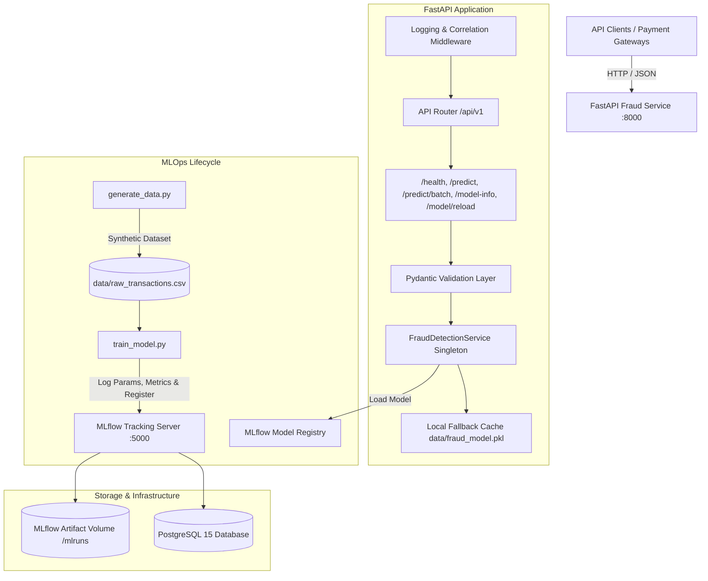

# Deploy Scalable Fraud Detection API with MLflow Model Management

[](https://www.python.org/)
[](https://fastapi.tiangolo.com)
[](https://mlflow.org)
[](https://www.docker.com/)
[](https://opensource.org/licenses/MIT)

A production-ready, containerized Machine Learning inference service for real-time financial fraud detection built with **FastAPI**, integrated with **MLflow** for experiment tracking and model registry management, and orchestrated with **Docker Compose**.

---

## Architecture Overview



---

## Key Features

- **High-Performance RESTful Inference**: Built on FastAPI with asynchronous routing, typed Pydantic v2 schemas, and millisecond-level response times.
- **MLOps & Model Lifecycle Management**: Programmatic experiment tracking and model registration via MLflow Model Registry.
- **Enterprise Fault Tolerance & Offline Fallback**: Dual-layer model loader that loads from the active MLflow Registry and seamlessly falls back to a serialized local artifact if the remote tracking server is unavailable.
- **Vectorized Batch Inference**: Supports batch scoring of up to 1,000 transactions in a single vectorized NumPy/Pandas pass.
- **Dynamic Hot-Reloading**: Zero-downtime model refresh endpoint (`POST /api/v1/model/reload`) for instant model rollouts.
- **Structured JSON Logging & Observability**: Standardized JSON logs with correlation IDs (`X-Request-ID`), client IP tracking, path metrics, and duration (`X-Process-Time-Ms`).
- **Multi-Stage Containerization**: Minimal, production-hardened Docker image with non-root security principles and internal health checks.
- **Full Docker Compose Orchestration**: Single-command startup of PostgreSQL, MLflow Tracking Server, and FastAPI Inference Service.

---

## Project Structure

```
.
├── app/
│   ├── __init__.py
│   ├── main.py                  # FastAPI entry point, lifespan, middleware & exception handlers
│   ├── api/
│   │   ├── __init__.py
│   │   └── v1/
│   │       ├── __init__.py
│   │       └── endpoints.py     # Endpoints: /health, /predict, /predict/batch, /model-info, /model/reload
│   ├── core/
│   │   ├── __init__.py
│   │   ├── config.py            # Pydantic BaseSettings environment configuration
│   │   └── logging.py           # Structured JSON logging formatter & setup
│   ├── models/
│   │   ├── __init__.py
│   │   └── schemas.py           # Pydantic request/response schemas with field validation
│   └── services/
│       ├── __init__.py
│       └── fraud_service.py     # Model loading, MLflow integration, and inference logic
├── data/                        # Synthetic transactions and local fallback model artifact (.gitignore)
│   ├── raw_transactions.csv
│   └── fraud_model.pkl
├── mlruns/                      # MLflow local tracking artifacts (.gitignore)
├── tests/
│   ├── conftest.py              # Pytest fixtures and test clients
│   ├── unit/
│   │   └── test_fraud_service.py# Unit tests for prediction logic & risk tiers
│   └── integration/
│       └── test_api.py          # Integration tests for all API endpoints & validation errors
├── Dockerfile                   # Multi-stage production Docker build
├── docker-compose.yml           # Orchestration for FastAPI, MLflow Server & PostgreSQL
├── requirements.txt             # Production Python dependencies
├── generate_data.py             # Script to generate synthetic transaction data
├── train_model.py               # Script to train, evaluate, log, and register model in MLflow
├── .env.example                 # Example environment variables
├── .gitignore                   # Standard gitignore for ML & Python projects
└── README.md                    # Comprehensive documentation
```

---

## Data Schema & Feature Engineering

The model evaluates transaction risk based on five core features:

| Feature Name | Type | Constraints | Description |
|---|---|---|---|
| `transaction_amount` | `float` | `> 0.0` | Transaction monetary value in USD |
| `time_of_day_hour` | `int` | `0 <= x <= 23` | Hour of day when transaction was initiated |
| `num_transactions_1h` | `int` | `>= 0` | Burst transaction count in preceding 1 hour |
| `avg_transaction_7d` | `float` | `> 0.0` | Historical 7-day average transaction amount |
| `location_risk_score` | `float` | `0.0 <= x <= 1.0` | Geolocation risk indicator (0 = safe, 1 = risky) |

---

## Quickstart Guide

### 1. Local Environment Setup

```bash
# Clone the repository
git clone <repository_url>
cd <repository_directory>

# Create and activate a virtual environment
python -m venv venv
# On Windows:
.\venv\Scripts\activate
# On Linux/macOS:
source venv/bin/activate

# Install dependencies
pip install -r requirements.txt
```

### 2. Configure Environment Variables

```bash
cp .env.example .env
```

### 3. Generate Synthetic Data & Train Model

```bash
# 1. Generate realistic transaction dataset
python generate_data.py --num-samples 5000

# 2. Train classifier, compute metrics, and register model in MLflow
python train_model.py --tracking-uri sqlite:///mlflow.db --model-name FraudDetectionModel
```

### 4. Run the API Locally

```bash
uvicorn app.main:app --host 0.0.0.0 --port 8000 --reload
```

---

## Docker Compose Deployment

Run the complete production stack (PostgreSQL, MLflow Tracking Server, and FastAPI Service) with Docker Compose:

```bash
# 1. Build and start all services
docker compose up -d --build

# 2. Verify running containers and health status
docker compose ps
```

Once running:
- **FastAPI Documentation (Swagger UI)**: [http://localhost:8000/docs](http://localhost:8000/docs)
- **FastAPI Health Endpoint**: [http://localhost:8000/api/v1/health](http://localhost:8000/api/v1/health)
- **MLflow Tracking UI**: [http://localhost:5000](http://localhost:5000)

To stop the services:
```bash
docker compose down
```

---

## API Reference & Examples

### 1. Health & Readiness Check
**Endpoint**: `GET /api/v1/health`

```bash
curl -X GET http://localhost:8000/api/v1/health
```

**Response (200 OK)**:
```json
{
  "status": "healthy",
  "service": "Fraud Detection API",
  "version": "1.0.0",
  "model_status": "loaded",
  "model_source": "mlflow_registry",
  "model_name": "FraudDetectionModel",
  "model_version": "1",
  "mlflow_tracking_uri": "http://mlflow:5000",
  "uptime_seconds": 124.5
}
```

---

### 2. Single Transaction Fraud Prediction
**Endpoint**: `POST /api/v1/predict`

#### Legitimate Transaction Example:
```bash
curl -X POST http://localhost:8000/api/v1/predict \
  -H "Content-Type: application/json" \
  -d '{
    "transaction_amount": 42.50,
    "time_of_day_hour": 14,
    "num_transactions_1h": 1,
    "avg_transaction_7d": 50.00,
    "location_risk_score": 0.05
  }'
```

**Response (200 OK)**:
```json
{
  "is_fraud": false,
  "fraud_probability": 0.0421,
  "risk_level": "LOW",
  "model_name": "FraudDetectionModel",
  "model_version": "1",
  "prediction_id": "pred-9f8a12bc44",
  "timestamp": "2026-10-06T05:50:00.123456Z"
}
```

#### High-Risk Fraudulent Transaction Example:
```bash
curl -X POST http://localhost:8000/api/v1/predict \
  -H "Content-Type: application/json" \
  -d '{
    "transaction_amount": 4500.00,
    "time_of_day_hour": 3,
    "num_transactions_1h": 9,
    "avg_transaction_7d": 65.00,
    "location_risk_score": 0.95
  }'
```

**Response (200 OK)**:
```json
{
  "is_fraud": true,
  "fraud_probability": 0.9634,
  "risk_level": "HIGH",
  "model_name": "FraudDetectionModel",
  "model_version": "1",
  "prediction_id": "pred-4a7b88ec10",
  "timestamp": "2026-10-06T05:50:05.987654Z"
}
```

---

### 3. Batch Transaction Evaluation
**Endpoint**: `POST /api/v1/predict/batch`

```bash
curl -X POST http://localhost:8000/api/v1/predict/batch \
  -H "Content-Type: application/json" \
  -d '{
    "transactions": [
      {
        "transaction_amount": 25.00,
        "time_of_day_hour": 12,
        "num_transactions_1h": 1,
        "avg_transaction_7d": 30.00,
        "location_risk_score": 0.02
      },
      {
        "transaction_amount": 4800.00,
        "time_of_day_hour": 2,
        "num_transactions_1h": 8,
        "avg_transaction_7d": 80.00,
        "location_risk_score": 0.92
      }
    ]
  }'
```

**Response (200 OK)**:
```json
{
  "total_transactions": 2,
  "fraud_detected_count": 1,
  "fraud_rate_percentage": 50.0,
  "predictions": [
    {
      "is_fraud": false,
      "fraud_probability": 0.0215,
      "risk_level": "LOW",
      "model_name": "FraudDetectionModel",
      "model_version": "1",
      "prediction_id": "batch-1",
      "timestamp": "2026-10-06T05:50:10.000000Z"
    },
    {
      "is_fraud": true,
      "fraud_probability": 0.9782,
      "risk_level": "HIGH",
      "model_name": "FraudDetectionModel",
      "model_version": "1",
      "prediction_id": "batch-2",
      "timestamp": "2026-10-06T05:50:10.000000Z"
    }
  ]
}
```

---

### 4. Input Validation & Error Handling
**Endpoint**: `POST /api/v1/predict` (Invalid Payload)

```bash
curl -X POST http://localhost:8000/api/v1/predict \
  -H "Content-Type: application/json" \
  -d '{
    "transaction_amount": -10.0,
    "time_of_day_hour": 28,
    "num_transactions_1h": 1,
    "avg_transaction_7d": 50.00,
    "location_risk_score": 1.5
  }'
```

**Response (422 Unprocessable Entity)**:
```json
{
  "error": "Unprocessable Entity",
  "message": "Input validation failed. Please check the supplied parameters.",
  "details": [
    {
      "field": "body -> transaction_amount",
      "message": "Input should be greater than 0",
      "type": "greater_than"
    },
    {
      "field": "body -> time_of_day_hour",
      "message": "Input should be less than or equal to 23",
      "type": "less_than_equal"
    },
    {
      "field": "body -> location_risk_score",
      "message": "Input should be less than or equal to 1",
      "type": "less_than_equal"
    }
  ]
}
```

---

### 5. Model Information & Hot-Reload
- `GET /api/v1/model-info`: Retrieves metadata, feature schema, and decision threshold.
- `POST /api/v1/model/reload`: Instructs the service to hot-reload the latest model version from MLflow without server restart.

---

## Running the Automated Test Suite

The test suite includes comprehensive unit and integration tests covering the model loading logic, probability threshold calculations, batch evaluations, and all HTTP validation error states.

```bash
# Run pytest with detailed verbose output
pytest -v

# Run with code coverage reporting
pytest --cov=app --cov-report=term-missing
```

---

## MLOps & Architecture Decisions

1. **FastAPI for Inference Engine**: Native async execution, automatic OpenAPI schema generation, and high-speed Pydantic v2 data validation ensure minimal latency for critical financial paths.
2. **MLflow Model Registry with PostgreSQL Backend**: Provides central governance, semantic versioning, reproducible experiment tracking, and artifact persistence across container lifecycles.
3. **Graceful Fallback & Resilience**: If network partitioning or cold startup delays occur between the API and MLflow server, the inference service automatically loads the local verified fallback artifact (`data/fraud_model.pkl`), ensuring 100% service uptime.
4. **Multi-Stage Docker Image**: Separates build tooling (`build-essential`, `gcc`) from the final runtime image, minimizing container image attack surface and deployment footprint.
5. **Observability by Design**: Every request is assigned a unique correlation ID (`X-Request-ID`) and tracked with microsecond duration metrics in structured JSON format for instant ingestion into ELK / Datadog / CloudWatch.

---

## Future Enhancements
- **Prometheus Metrics**: Expose `/metrics` for real-time inference latency histograms, throughput, and fraud rate counters.
- **Data & Concept Drift Monitoring**: Integrate Evidently AI / Evidently Cloud for statistical KS-test distribution drift detection on transaction amounts and risk scores.
- **Authentication & Rate Limiting**: Implement API Key or OAuth2 JWT token authentication with Redis-backed token bucket rate limiting.
- **CI/CD Automation**: GitHub Actions workflow for automated testing, linting, Docker image building, and semantic version tagging.

---

## License
This project is open-source and licensed under the [MIT License](LICENSE).
